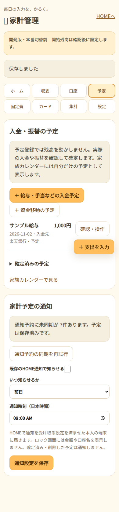

# 家計簿とHOME家族カレンダーの連携（開発版・本番未反映）

2026-11-02 JST。`feature/budget-renewal-20261102` の `2069bc50675c3f484f003e3348909491e24f24b5` から追加。利用者の許可は開発・ローカル検証まで。本番DB変更・マージ・本番デプロイ・実通知の送信はしていない。

## 既存実装の調査

| 領域 | ソースで確認した既存動作 | 再利用・追加箇所 |
| --- | --- | --- |
| HOME本人確認 | `src/calendar.ts` はHOMEセッションから利用者を確定し、`X-Calendar-User` の食い違いを拒否。旧トークン・利用者偽装ヘッダーを転送しない | 既存チェック後に本人の家計予定だけを返す |
| 公開範囲 | `calendar-worker.js` のcalendar ACLとevent visibility。カレンダーと予定両方の閲覧権限・現在の所属を検証 | 家計予定は共有DBへコピーせず、本人専用の仮想カレンダーをHOME側で合成。家庭のadmin/operatorでも他人の家計には入れない |
| 予定管理 | GET `/events?from&to&calendar_id`、繰り返し展開、更新・削除の本人チェック | 家計簿を正本にして取得時に投影。固定のsource IDを使い、家計簿側の変更を反映。一般カレンダーAPIから編集・共有・削除はできない |
| 通知予約 | calendar-workerの`calendarNotificationPayload`と`syncCalendarNotification`から通知センター`/api/calendar-sync`へ。予定ごとの予約とHOME通知先メタデータ | 既存のWeb Push購読・送信・ログを使用。家計専用の内部同期入口だけ追加。共通パスワードをHOMEやブラウザへ追加しない |
| 配信時の本人検証 | 通知Workerの`checkHomeCalendarDelivery` → HOME `/internal/notification-check`。端末の現在のHOME user/session、アプリ権限、予定の閲覧可否を確認 | `bg…`の家計sourceはHOMEで本人・有効なセッション・家計/カレンダー/通知の利用権限・予定の現バージョン・未完了を再検証 |
| 通知タップ | `/wagaya/sw.js`は通知payloadのURLを同一originに限定して開く。旧`notify-sw.js`はカレンダー固定だった | mounted版はそのまま使用。旧版も同一originチェック付きで指定URLを引き継ぐ |
| Google予定 | `/google-events`、本人用非公開ICSの読み取り、独立した表示 | 変更しない。家計情報をGoogleへ送らず、iPhone標準カレンダーとの同期も追加しない |

これはGitHubの固定版で確認した内容であり、現Cloudflare Worker全文・Bindings・実DB・iPhoneの購読設定との一致は未確認。利用者から既存のiPhone通知・Google表示が動いているとの報告あり。

## 開発版の動作

- 家計簿に「予定」タブを追加。給与・手当などの入金予定、口座間振替予定を登録・編集・削除・実行確定・確定取消できる。通常の支出入力の3支払元は維持。
- 登録・編集・削除だけではjournal/残高/収支を動かさない。明示した開始日・開始残高がなければ予定を確定できない。入金確定は収入と入金先、振替確定は出金元と入金先だけに反映。取り消すと反対記録を追加して予定へ戻す。
- 入金・振替予定を口座ごとの見込残高に含める。現在残高、入金予定、引落・振替予定、予定反映後の残高を区別。
- 銀行/現金の固定費とカード引落予定も自動表示。カードで払う固定費はカード請求見込みに含め、銀行引落として同じ固定費を重ねて表示しない。カード利用は従来どおり利用時に支出、カード引落は銀行/未払だけ減算。
- HOMEのカレンダーに「家計の予定（自分だけ）」を表示。期間/カレンダーフィルターに従う。確定済みは✓、削除済みは表示しない。金額/口座は本人の詳細でだけ確認できる。
- カレンダー詳細に「家計簿で確認・操作する」。通知も同じsource付きURLへ。sourceは本人IDと取引種別/IDから導出し、他の利用者で同じ取引IDがあっても別になる。家計簿で現在のHOME本人を再確認し、対象外/削除済みは404。
- カレンダーに戻った時は本人確認と再取得。変更・完了・削除した家計予定の詳細を更新し、本人変更や権限喪失時は詳細を閉じる。

## 通知と失敗時の扱い

通知は利用者が有効化し、日本時間の時刻と当日/1・2・3・7日前を選ぶ。初期はOFF。HOMEで既に登録した本人の端末購読を再利用する。通知タイトル・本文は一般的な確認案内で、金額・口座名・給与名を通知保存先やロック画面へ渡さない。金額0以下・確定済み・削除済みは通知しない。

HOME DBの`budget_calendar_outbox`は家計状態/監査と同じD1 batchで更新。CASに失敗した操作や監査失敗では通知予約だけが残ることもない。`source_id`は一定、変更はversionを進める。通知センターには呼び出し元の金融payloadやownerを受け付けず、推測困難な現行job番号をHOMEに照会した結果だけを同期する。job番号はブラウザへ返さない。

通知センターの`budget_notification_sources`でsourceに1つのrule IDを固定する。同じ操作の再送や同じjobの再試行では予定やruleを追加しない。変更時も既存の配信ログを消さず、既存の`UNIQUE(rule_id,fire_key)`で同時刻の重複配信を防ぐ。古いversionは上書きできない。

ネットワーク障害は家計の保存結果と分離。未同期は画面に件数と再試行を表示し、既存HOME Cronでも最大100件ずつ再試行する。金銭操作は繰り返さない。古い通知予約が残っても、配信直前の現バージョン検証で抑止する。通知経路の障害中に通知時刻を過ぎた場合は到達を保証しない（過去時刻の再通知を勝手に行わない）。

## DBと反映範囲

- HOME：追加migration `0028_budget_calendar.sql`。本人別の同期キュー1表＋indexだけ。家計簿本体の0027も必要。既存行・残高・権限付与は変更しない。
- 通知センター：追加表の定義 `cloudflare/notification-center-api/budget-calendar.sql`。対応コードは有効なHOME jobの処理時にも同じ表を準備できる。既存rule/log/購読の移動・削除はしない。
- calendar-workerとcalendar-db：コード・schema・予定行・公開範囲設定の変更なし。HOME側で返す本人用投影だけ。
- 新Secret/Binding/Cron式は不要。既存のHOME↔通知のService Bindingを使う。**HOMEの`BUDGET_CALENDAR_ENABLED=1`は承認後だけ設定する。未設定なら同期はOFF。** 毎月自動生成は既存開発版の`BUDGET_SCHEDULES_ENABLED`も承認後に有効化。

## ローカル検証

合成ユーザー/口座/予定/購読だけを使用。通知送信部分をスタブ化し、実Push/本番ネットワークへ送信しない。

- 追加の家計予定・同期・配信・Service Workerテスト：11件成功。本人以外、偽owner、削除済みリンク、通知権限取消、ログアウト、旧version、同期障害と再送、原子的rollback、固定費/カード予定の月次・休日・編集・確定/取消/削除を検証。
- 家計/既存通知/共有範囲/繰り返し/複数通知/取得キャッシュ/HOME権限・並び順の回帰：33件成功。合計44件。
- TypeScript、Worker dry-run、画面JS/通知Worker/カレンダーinline JSの構文確認成功。
- 合成SQL復元・0027/0028の順次適用・通知DB追加表・旧行保持/差異検出：Python2件成功。
- Chromium＋実際のローカルHOME/D1：入金予定、リンクから操作画面、確定・取消・削除、通常支出/分割/振替/固定費を検証。320/390/768/1280幅で横はみ出し/JSエラーなし。カレンダー詳細のリンクと編集禁止も実ソースから確認。

以前からの通帳金融テストの失敗1件は家計簿本体の資料を参照。今回追加で、既存`calendar-home.test.mjs`の同じRequestを再使用した失効チェック1件が失敗することを確認し、改修前の基準ソースでも同じ失敗を再現した。calendar-workerは変更していない。今回の実HTTPによる本人/権限取消/ログアウト・配信直前の再検証は成功。この基準試験の整理は別途残す。

| 予定一覧（合成） | 直接リンク先（合成） |
| --- | --- |
|  |  |

再検証は家計簿本体の手順に`test/budget-calendar.test.mjs`と既存カレンダー試験を追加。画面試験は更新した`scripts/check-budget-ui.mjs`を使用。

## 本番へ進む前の確認・許可待ち

1. 家計簿本体のレビュー、実HOME本人ID・開始日/実残高/カード未払・引落設定・旧データの移行範囲の確認。
2. 現HOME/通知/カレンダーのWorker全文、DB、Bindings、Cron、iPhone購読の現設定を読み取りで照合。既存設定をソースから決めつけない。
3. HOME/通知/カレンダーの最新SQL退避と空DBへの復元予行。`scripts/check-budget-backups.py`は`--migration`を複数回指定でき、HOMEの0027→0028を順次照合できる。通知DBにも追加表SQLの前後比較を使える。実データを公開リポジトリへ入れない。
4. 本番変更は利用者が具体的な差分を確認して許可した後だけ。通知Worker対応→HOMEの追加schema/コード→本人権限・移行の照合→連携フラグの順で準備し、実行前に最新の変更との再照合を行う。新機能を有効化する前に既存の共有/Google/通知/家計履歴の前後一致を確認。
5. iPhone実機で本人の予定表示、通知到達、タップ先、完了後の停止、ログアウト/別アカウント時の非表示を確認。他家族の端末へ家計通知が届かないことも確認。未実施。

既存データへの変更、本番のDB/Worker/フラグ/予約/購読変更、マージ、デプロイはすべて保留。
