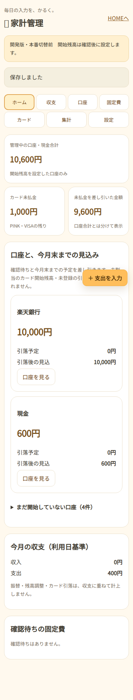
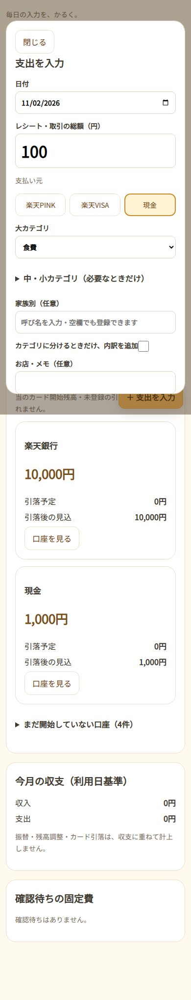
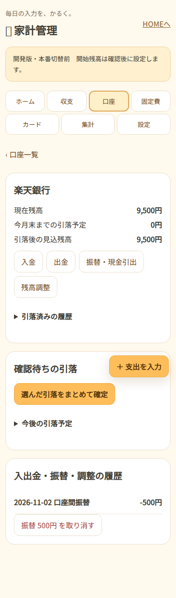

# 家計簿リニューアル：開発版・本番反映禁止

2026-11-02。開発ブランチ `feature/budget-renewal-20261102`。HOME基準 `9bd59685358795bae4fa9c4cc5e31a77c2804ed4`、旧静的ページ調査 `main@52b73aa46fcc08abb33e5f5c1f7babea7b013dbc`。

**利用者の許可は開発・テストまで。本番DB変更・マージ・本番デプロイ・開始残高設定は未許可。** 実データの取得や実残高の推測は行っていない。旧アプリは変更せず、新画面の予定パスは `/wagaya/apps/household-budget/`。現時点の公開URLではない。

## 調査で確認した既存構成

| 項目 | ソースで確認した内容 | 開発版での扱い |
| --- | --- | --- |
| メニュー | `kanriapp/kakeibo-index.html`。入力・状況・固定費・予算・資金繰りへリンク | 旧画面を残し、HOMEアプリを追加する差分だけを準備 |
| 収支 | `kakeibo-input.html` version 6。expense/income/advance/recovery、日付・反映月・メモ等 | 旧種別と情報を保持。支出/収入/立替/回収/返金の入力 |
| 支払元 | PINK/VISAは翌月反映。現金・銀行等も旧記録に存在 | 普段の買い物はPINK/VISA/現金。銀行入出金は口座画面 |
| 大中小カテゴリ | `kakeibo-category-tree-v1` は端末内。大カテゴリ・middle/small・person・expenseNatureが旧行に保存 | 木・非表示設定・旧行を維持。大カテゴリだけで登録。下位は任意 |
| レシート分割 | 旧画面は `receiptId/receiptTotal/splitIndex/splitCount` で複数行に分割 | 整合した行を1取引＋内訳へ再構成。金額/行数不整合は原本保持・確認待ち |
| 家族別 | 旧行・分割行の `person` | 取引/内訳で維持、家族別集計・絞り込み |
| 固定費 | `kakeibo-fixed.js`。`plan.fixedExpenses`、固定ID/対象月で支出へ登録 | 金額固定/変動テンプレート、予定と確定を分離。旧ルールは停止・確認待ちで移行 |
| 資金繰り | `plan.cashflowAccounts` の残高を手入力。入出金/支払済みフラグと残高台帳は未連動 | 旧値を開始残高と決めつけない。新しい口座台帳に明示設定 |
| 保存 | localStorage `kakeibo-app-stable-v3`/plan/deletedIds と `api.cetus.fun/api/app-data` のJSONを合流 | 元JSONを丸ごと保持。旧APIへ書き戻さず本人専用の新台帳へ取り込む |
| DB | リポジトリの旧APIソースは `app_data(app='kakeibo-app',data_key='main')` と履歴退避 | 実Workerのbinding/実スキーマ/最新コード一致は未確認。要本番前監査 |
| 認証 | 確認した旧静的ページにHOMEチェックはなく、旧APIソースは共通 `X-App-Password` | HOMEセッション＋personal_app_access。親/家族/運営者という理由で他人のデータへアクセスできない |

旧APIソースを現在の本番Workerと同一だとは断定していない。これまでの「HOME本人限定」の希望と、確認した旧ソースの方式に差がある。実機・本番設定の確認が必要。

## データと会計の決め方

- `budget_states`：本人IDを主キーとする状態・revision・最終操作。`budget_operations`：操作番号、内容hash、操作JSON、前後hash、版、基準日。監査行は更新/削除をトリガーで禁止。
- 操作は現在版との比較更新と監査追加をD1 batchで一括確定。再送は同じ操作番号とhashなら再実行しない。違う内容・古い版・二重引落は409。途中失敗時は口座2本も監査も戻る。
- 口座開始残高は未設定なら「未設定」。初期の銀行名は旧資金繰りの既定一覧を再利用、実際の残高・管理対象・カード未払金を設定したとは扱わない。口座名/財布は追加可能。
- 残高開始日は候補2026-11-02を表示するが未適用。**開始日の取引前残高**を本人が確認して設定。旧収支・旧資金繰り残高・未払金を自動再計上しない。
- 取り込んだ収支はまず履歴/集計専用。開始日以後の旧取引を残高へ反映する時も、取引と支払元を明示して確認する。旧原本と確認待ちは残す。
- 口座振替/現金引出は出金元と入金先へ同時反映。家計全体の収支には入れない。残高調整は理由付き、取消は反対記録を追加。
- カード利用は利用日に支出・未払金増。カード引落は銀行と未払金を減らすが、再度支出にはしない。開始時未払金は最初の請求月へ明示割当し、重複割当を禁止。
- 請求額は手動修正。ポイントは未払調整、返金は支出の減額、手数料は支出の増額として説明を記録。不明差額は調整せず未照合として残し、残った未払/過払を表示。
- 引落は予定状態で残高を変えない。確認待ち優先、未来/確定済みは折りたたみ。銀行固定費とカード引落を同じ操作でまとめて確定できる。
- 固定費はルール×月で一意。変動型は前月の実額/予定額を初期値にする。カード固定費は利用確認で支出/未払へ移し、請求の見込に二重に足さない。
- 現在残高・今月末までの引落見込・カード未払金・未払差引額を分けて表示。口座合計は開始した管理対象のみ。未開始口座や未割当未払をゼロの実残高として扱わない。
- 従来の `settleMonth` 集計と利用日集計を切り替え、大カテゴリ/家族別集計を保持。旧の予算・積立・資金繰り設定は原本として読み取り可能。

## 月替わり・銀行休日

画面を開くと当月/翌月の未生成予定を補完する。定期処理 `runBudgetSchedules` も実装し、`BUDGET_SCHEDULES_ENABLED=1` の時だけ本人権限のある既存台帳へ毎月の予定を作る。**定期処理は引落を確定しない。既定は無効。**

31日指定はその月の末日、土日と12/31〜1/3、および本人が登録した銀行休日は翌営業日へ繰り越す。祝日・振替休日の全国自動取込は未実装。休日設定の変更は未来の未確定・手動指定していない予定だけ再計算し、確定済みの日付は変更しない。実際の引落日は修正可能。

## 画面

- ホーム：管理口座合計／カード未払／差引額、口座ごとの今月末見込、今月の収支、確認待ち。
- 入力：金額中心、PINK/VISA/現金3ボタン、大カテゴリのみ登録可。分割時だけ内訳を展開。前回の支払元/カテゴリ/対象者を本人の状態に保存。
- 口座：入出金・振替・調整、確認待ち引落とまとめて確定、未来と確定済み履歴、取消。
- 固定費：引落口座/カード別に折りたたむ。固定/変動、金額だけ修正、停止。
- カード：未払/過払、締め日・支払月/日・口座設定、開始時未払の請求割当、請求額/差額、引落/取消、カード固定費の利用確認。
- 集計/設定：利用日/旧反映月、家族/カテゴリ、原本、認証情報を除いたJSON移行、JSONバックアップ、変更履歴。

通信中断時の未確認操作は、そのHOME本人用のsessionStorageに操作内容と番号だけ一時保持する（台帳全体や銀行認証情報は保存しない）。本人の認証後だけ読み、同じ操作番号で再試行する。画面表示の許可とデータAPIの権限は別々に確認する。

## バックアップ・移行・復元の準備

実DB変更前に、HOME DBと旧app_data DBの最新SQL export、旧Worker全文/Bindings、旧ブラウザのキャッシュ・カテゴリ木を保存して一致確認する。**まだ取得・実行していない。**

- `scripts/export-legacy-budget.js`：旧画面で手動実行するキャッシュ確認用JSON出力。クラウド設定/パスワードを読まない。最新クラウドと一致確認した後に使う。コードは用意したが利用者へ実行を依頼していない。
- `scripts/check-budget-backups.py`：SQLをメモリーSQLiteに復元して整合性確認、空DBへ再復元して同一性確認、0027の追加変更後に旧行/定義が一致するか比較。実データを出力しない。合成DBで検証。
- `scripts/replay-budget-audit.mjs`：本人用JSONバックアップを初期状態から操作順に再構成し、各版のhashと最終状態が一致するかオフライン確認。
- 復元は退避SQLを別の空DBへ読み込んで整合性/件数/内容一致を先に確認。承認した切戻し先と時点を選ぶ。本番へ書き戻すコードや自動復元は実行しない。新台帳使用開始後に古いDBへ戻す場合は新規分の退避/監査照合が必須。
- 旧Workerには `HOME_KAKEIBO_MIGRATED=1` の時だけ旧kakeibo-appの読込/保存/削除/公開読込を閉じる任意ゲートを用意。他アプリ/DB行は変えない。現在の実Workerとの全文照合と本番許可後にのみ反映する。旧端末の未同期データを回収してから切替え、二重運用はしない。

## 本番前に確認が必要なもの

1. 実際のHOME本人IDと家計簿所有者の対応。migrationは個人アプリを登録するだけで、**personal_app_accessを誰にも自動付与しない**。ユーザーの確認後に本人だけへ付与。
2. 対象の銀行/財布・開始日・その日の取引前残高・開始時カード未払金。旧履歴を残高へ適用する範囲。
3. 各カードの締め日・支払日・支払月・引落口座、銀行休日。カード設定の既定値を事実として適用しない。
4. 実旧DB/現Worker/最新クラウドと全端末キャッシュ・カテゴリの整合。旧原本を新台帳へ引き継ぐ本人の明示確認。
5. 最新バックアップと復元予行、移行前後の既存テーブル全行/定義照合。新台帳を使う前に完了させる。
6. 元の保存経路の停止、既存HOME/通帳への影響、スマホ/PCの実機・実データによる確認（破壊的テストはしない）。

## 制限と検証の区分

- 実残高・本番DB・iPhone実機・旧Workerの現設定は未確認。本番で使える完成版として公開していない。
- JSON状態は1.8MBを超える変更を原本保持のまま停止する。実データの容量は移行前に確認し、大きい場合は正規化保存の段階移行を設計する。監査は毎回の全状態を重複保存せず、操作JSONと前後hashを記録する。
- 既存の通帳金融テスト `passbook-finance.test.mjs` に、利息試験の集計件数が `4 !== 1` になる失敗を確認した。同じ失敗は改修前の基準コードでも再現。無関係な通帳処理は変更しない。今回の家計テストと区別して報告する。
- 開発テスト/画面確認の結果は作業完了時の記録に追記する。

## 開発検証結果（2026-11-02）

- TypeScript `npm run check`：成功。Worker `wrangler deploy --dry-run`：成功（アップロード・デプロイなし）。
- 家計コア・本人専用API・旧経路停止ゲート・既存HOMEレイアウト・既存家族基盤：合計24テスト成功。
- 合成バックアップの復元・移行前後照合・旧JSON差異の検出：Python 1テスト成功。
- ローカルHOME認証＋Miniflare D1＋Chromium：開始設定、通常支出、カテゴリ省略、分割合計、固定費の毎月生成/確定、振替、画面遷移を操作。振替保存成功後の応答消失→再読込→同じ操作の再送で二重反映しないことを確認。
- 幅320/390/768/1280pxで横はみ出しなし、JavaScriptエラーなし。以下の画面見本はすべて合成データ。
- 本番データのバックアップ/復元、実カード明細との照合、本番移行は未実施。通帳の既知の基準テスト失敗1件は上記のとおり別途残る。

| ホーム | 入力 | 口座詳細 |
| --- | --- | --- |
|  |  |  |

再検証：`cloudflare/home-worker`で`npm ci`、`npm run check`、`npx wrangler deploy --dry-run --outdir .wrangler/test-build`の後、`node --test --test-concurrency=1 test/budget-core.test.mjs test/budget-api.test.mjs test/budget-legacy-gate.test.mjs test/home-layout.test.mjs test/family-foundation.test.mjs`。リポジトリのルートから`python scripts/test_check_budget_backups.py`。

画面試験：PlaywrightとChromiumを用意し、リポジトリのルートから`node scripts/check-budget-ui.mjs`。必要に応じて`BUDGET_PLAYWRIGHT_MODULE`（Playwrightのモジュールパス）、`BUDGET_CHROMIUM`（ブラウザ実行ファイル）、`BUDGET_FONT_ROOT`（任意の日本語フォント）を指定する。試験は合成ユーザー/残高のローカルDBを作り、本番へ通信しない。
